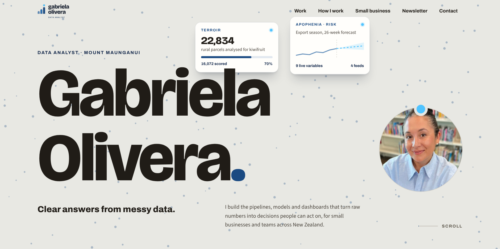

# Gabriela Olivera, Portfolio



[](https://github.com/gabrielaoliveranz/gabrielaoliveranz.github.io/actions/workflows/checks.yml)

Personal portfolio and small-business site for a data analyst in
Mount Maunganui, New Zealand. No blog, no build step: hand-written
semantic HTML, shared design tokens and CI checks, the same approach as
the [Terroir case study](https://github.com/gabrielaoliveranz/terroir-case-study).

## Pages

| Page | Status |
| --- | --- |
| `index.html` (`/`) | Live |
| `small-business/index.html` (`/small-business/`) | Live, linked from the header nav |
| `case-studies/litchfields-grain/index.html` (`/case-studies/litchfields-grain/`) | Live, linked from the home page and the small-business page |
| `privacy/index.html` (`/privacy/`) | Live, linked from every page's footer |
| `404.html` | Live, deliberately not in `sitemap.xml` (`noindex`) |

Every indexable page is listed in `sitemap.xml`.

## Structure

```
gabrielaoliveranz.github.io/
├── index.html
├── 404.html
├── small-business/index.html
├── case-studies/litchfields-grain/index.html
├── privacy/index.html
├── favicon.ico                        # root icon for search engines (the pages link assets/favicon.png)
├── CNAME                              # custom domain: gabrielaolivera.nz
├── google081f77d423ca3a8e.html        # Google Search Console verification, keep as is
├── sitemap.xml
├── robots.txt
├── assets/
│   ├── site.css / site.js             # the site's styles and scripts, used by every page
│   ├── case-study-v2.css              # extra styles for the case study page
│   ├── styles.css                     # previous design's stylesheet: no page loads it, but check:og-card
│   │                                  # still reads --accent from it (see NEXT-STEPS.md)
│   ├── favicon.png
│   ├── cv/gabriela-olivera-cv.pdf     # the real CV
│   ├── email/                         # images used by the newsletter emails
│   ├── fonts/                         # self-hosted Archivo, Source Sans 3 and Bricolage Grotesque
│   ├── images/                        # headshot, project screenshots, logos, OG cards
│   │   └── case-studies/              # client logo and dashboard images for the case study
│   └── preview/hero.png               # this README's cover image
├── scripts/                           # html, link, a11y, overflow, contrast, asset,
│                                      # canonical, footer and OG card checks, plus the OG card generator
├── .github/workflows/checks.yml       # runs the checks on every push
├── package.json / package-lock.json
├── .htmlvalidate.json / .htmlvalidateignore
├── .gitattributes / .gitignore
├── LICENSE.md
└── NEXT-STEPS.md                      # what's pending
```

Working notes for editing the site (`CLAUDE.md`) and the Litchfields Grain
case study PDF are kept locally and are not part of this repository.

## Replacing content later

- `assets/images/headshot.jpg`: 800×800px, square crop
- Project screenshots in `assets/images/`: 1600×900px (16:9) or 1600×1000px
- `assets/cv/gabriela-olivera-cv.pdf`: whenever the CV is replaced, swap
  this repo's copy in the same change. There is no visible "last updated"
  date on the site to keep in sync.

## Local preview

```bash
npm install
npm run serve   # http://localhost:8080
```

## Checks

```bash
npm run check   # html-validate, linkinator, axe-core, overflow, contrast states, asset paths,
                # untracked files, OG cards, canonical URLs, footer (CI runs all of these
                # except the small-business OG card check)
```

## Regenerating the OG cards

`assets/images/og-card.png` and `assets/images/og-card-small-business.png`
are rendered from templates in `scripts/`, not hand-edited. The case study
card (`assets/images/og-card-litchfields-grain.png`) is a static image with
no generator.

```bash
npm run generate:og-card                  # home page card
npm run generate:og-card:small-business   # small-business page card
```

## Live

https://gabrielaolivera.nz/

## Licence

CC BY 4.0, see [LICENSE.md](LICENSE.md).
